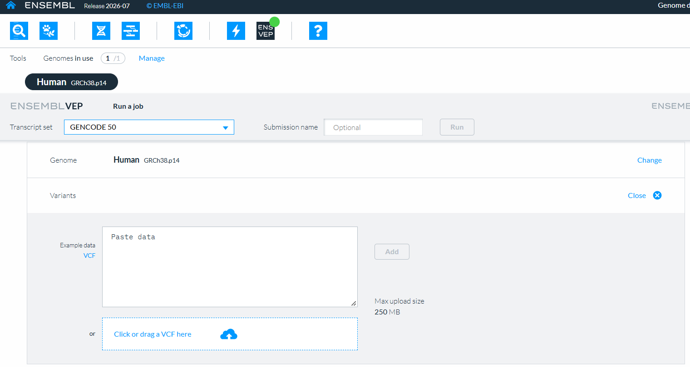

Para este trabajo usamos la página de [ensembl](https://www.ensembl.org/), y la herramienta [VEP](https://www.ensembl.org/tools/vep) (Variant Effect Prediction) (la cual ha sido actualizada recientemente), para ello seleccionamos el genoma sobre el cual queremos hacer la anotacion de las variantes, en nuestro caso selecionamos la opción de HumanGRCh38.p14, además seleccionamos las diferentes opciones sobre las que trabajar, como "variant representation: HGVS" para la representación de variantes o "Allele frequences: gnomAD" para identificar la frecuencia alélica de la variante a reconocer. Las opciones necesarias serán diferentes en función de lo que esperemos de cada variante.

Para este trabajo cargaremos los archivos .vcf en la opción de variantes, también podemos escribir manualmente los parámetros de la variante:

